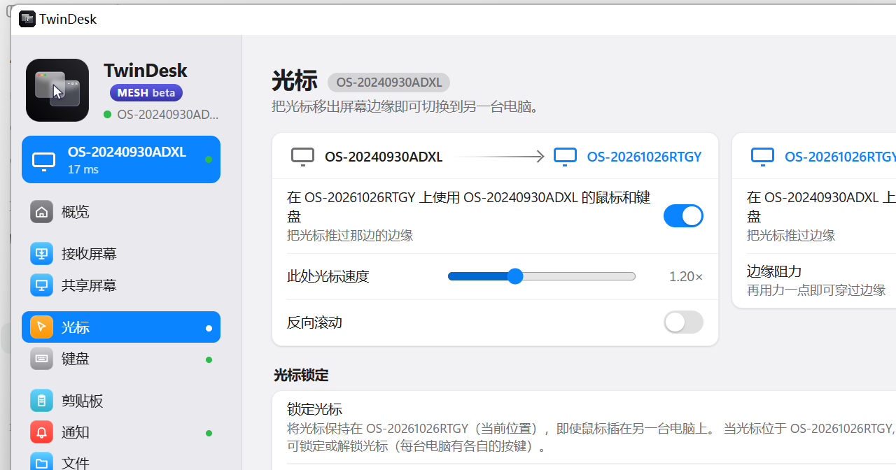
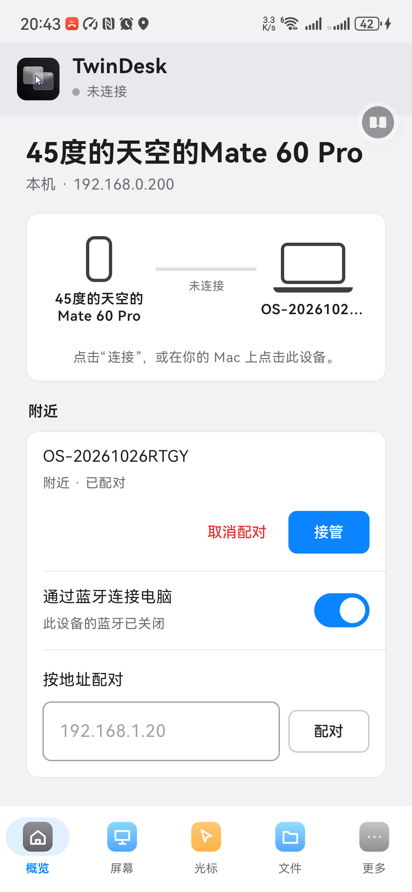
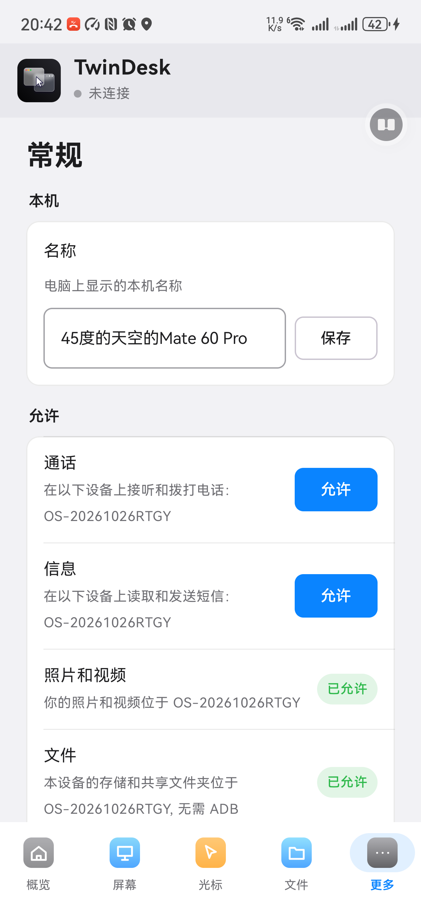

# TwinDesk 中文版（非官方汉化）

把开源软件 [TwinDesk](https://github.com/InukaAsith/TwinDesk) 的界面汉化成中文的**非官方**补丁 + 成品包。

> **这不是官方项目**，与作者 inukaasith 无关。原项目为 GPL-3.0 许可，本仓库按同一许可分发。



| Android | Android |
|---|---|
|  |  |

---

## 下载

到 [Releases](../../releases) 页面下载：

| 文件 | 说明 |
|---|---|
| `TwinDesk-CN-Windows-2.4.0.zip` | Windows 免安装版，解压后双击 `TwinDesk.exe` |
| `TwinDesk-CN-Android-2.4.0.apk` | Android 版（Android 10+） |
| `TwinDesk-CN-Windows-Patch.zip` | 已安装官方版时使用，覆盖界面文件 |

## 使用

### Windows（免安装）

1. 解压到一个固定目录，例如 `D:\TwinDesk`
2. 双击 `TwinDesk.exe`
3. 首次运行若提示"Windows 已保护你的电脑"，点“更多信息 → 仍要运行”

删除文件夹即卸载。

### Windows（已装官方版，只打汉化补丁）

1. 先安装官方 TwinDesk 2.4.0
2. 解压 `TwinDesk-CN-Windows-Patch.zip`
3. 右键 `安装汉化.cmd` → 以管理员身份运行
4. 重新打开 TwinDesk

还原英文：运行 `还原英文界面.cmd`（需要管理员权限）。

### Android

1. 先卸载手机上已有的 TwinDesk（签名不同，无法覆盖安装）
2. 安装 `TwinDesk-中文版-Android-2.4.0.apk`，允许“安装未知应用”
3. 打开后与电脑重新配对（卸载会清除旧配对）

> **不要**再用电脑端的“安装完整版”去覆盖手机端，那会装回官方英文版。

## 汉化范围

- Windows：主界面、所有设置页、配对流程、托盘菜单、文件选择框标题、多设备（Mesh）模式
- Android：主界面、五个标签页、全部二级页面（通话/信息/照片/文件访问/键盘/远程/剪贴板/通知/声音/相机/常规）、配对引导、权限提示
- 仍可能残留：极少数冷门错误提示、协议日志、系统级弹窗

## 已知问题

- 软件自动更新后会覆盖汉化，需要重新打补丁（Windows）或重装（Android）
- Android 版使用自签名证书，与官方版不兼容
- 部分中文句子由英文片段拼接，语序可能略显生硬

## 原理

### Windows

汉化是一个运行时翻译层 `windows/i18n-zh.js`：监听 DOM 变化，把英文文本节点和 `placeholder/title/aria-label` 替换成中文。不修改程序逻辑。

需要改动的只有各 HTML 的 `<head>` 加一行脚本，以及 `shared/traymenu.js`（原生托盘菜单）和 `windows/ipc.js`（文件对话框标题）。

```html
<script src="../shared/i18n-zh.js"></script>
```

> 注意：`windows/mesh/app.html` 带有 `<base href="../">`，脚本路径必须写成 `../shared/i18n-zh.js`。

### Android

Android 版界面文字硬编码在 Kotlin 代码里，因此采用：反编译 APK → 替换 smali 中的 `const-string` 字面量 → 用 apktool 回编译 → zipalign → 自签名。详见 [android/README.md](android/README.md)。

## 许可与署名

- 原项目：TwinDesk，Copyright (C) 2026 inukaasith，GPL-3.0
- 上游：https://github.com/InukaAsith/TwinDesk
- 本仓库的汉化改动同样以 GPL-3.0 发布，详见 [LICENSE](LICENSE) 与 [NOTICE.md](NOTICE.md)

## 免责声明

汉化为个人使用所做的非官方修改，按原样提供，不附带任何担保。请自行评估风险，重要数据请提前备份。
